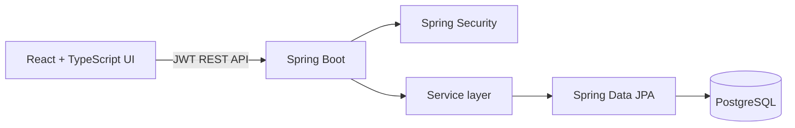
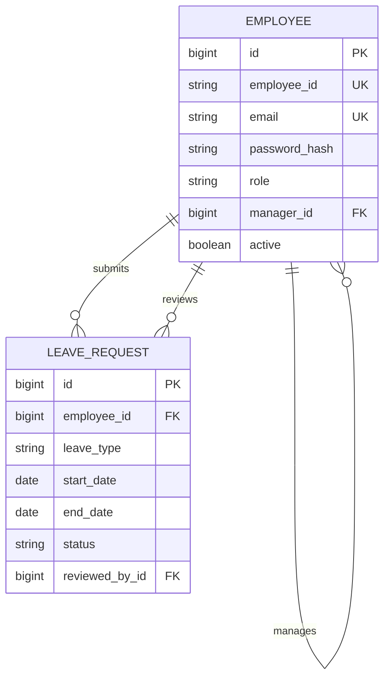
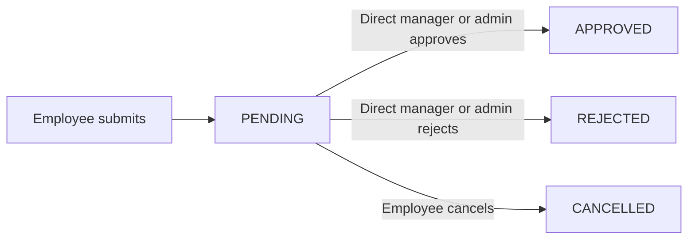

# PeopleFlow Employee Management System

PeopleFlow is a production-style employee management application for reporting hierarchies and end-to-end leave approvals. Employees request and track time away, managers make auditable decisions for direct reports, and administrators maintain the organization from one responsive workspace.

## Features

- Secure JWT login with BCrypt password hashes and disabled-account enforcement
- Self-referencing employee hierarchy with reporting-cycle protection
- Employee dashboard, profile, manager details, direct reports, and leave history
- Complete `PENDING → APPROVED / REJECTED / CANCELLED` leave workflow
- Relationship-level authorization: only the direct manager or an admin can decide a request
- Manager approval queue, rejection comments, and decision history
- Searchable admin directory with create, edit, roles, managers, and activation controls
- Backend validation, structured errors, responsive states, confirmations, and notifications
- Automatic local demo data, Docker images, and backend workflow tests
- Annual Vacation, Sick, and Personal leave balances with weekend-aware working days
- Manager team calendar and server-side overlap warnings
- Immutable audit trail and a role-protected administration portal

## Architecture



The repository is a modular monolith. Controllers own HTTP concerns, DTOs define the public contract, services enforce business rules and authorization, repositories handle persistence, and JPA entities remain private to the backend.

```text
copart/
├── frontend/              React, TypeScript, Vite, Tailwind
├── backend/               Java 21, Spring Boot, Maven
├── docs/                  Project documentation
├── docker-compose.yml     Web, API, and PostgreSQL
├── .env.example
└── README.md
```

## Data model

`Employee.manager_id` is a nullable foreign key back to `Employee.id`, supporting any depth of reporting chain. Unique constraints protect both employee ID and email. `LeaveRequest` belongs to an employee and optionally records the reviewer, review time, and comment. Password hashes never appear in DTOs or API responses.



## Leave workflow



Only pending requests may transition. An employee cannot review their own request. The API checks the direct reporting relationship for every decision; frontend visibility is only a convenience, not the security boundary.

## Leave balances and accrual

Each employee receives annual balances of 15 Vacation, 10 Sick, and 5 Personal working days. Saturdays and Sundays are excluded from request duration. Submission verifies availability but does not reserve or deduct days. Approval locks the balance row and deducts atomically with the leave decision; a second approval cannot drive the balance negative. Rejected or pending-cancelled requests never change balances. `OTHER` leave remains untracked.

Balances are stored per employee, leave type, and calendar year in `leave_balances`; remaining days are calculated as `total_allocated - used`. Administrators may increase or reduce allocations no lower than used leave, and must provide a reason.

## Team calendar and conflicts

Managers have a monthly Team Calendar showing approved and pending leave for direct reports without exposing reasons. When reviewing a request, the API finds overlapping approved requests for other employees under the same manager and returns a per-day availability warning. This is advisory and never automatically rejects a request.

## Audit trail and admin portal

Important leave, employee, manager, role, status, and balance changes create an `audit_logs` record inside the same backend transaction as the business operation. Records contain the actor, action, entity, timestamp, and a safe human-readable description. There are no update or delete APIs for audit data.

The ADMIN-only portal contains organization statistics, employee management, leave-allocation administration, and pageable audit logs with user, action, entity, and date filters. Backend method security protects every `/api/admin/**` route; employees and managers receive HTTP 403 and unauthenticated callers receive HTTP 401.

## Run with Docker

This is the recommended setup. Install Git and Docker Desktop (or Docker Engine
with Compose on Linux). Java, Maven, Node.js, npm, and PostgreSQL are included
in the containers and do not need to be installed separately.

See the **[complete setup guide](docs/SETUP.md)** for prerequisite installation
and copy-paste commands for macOS, Windows, Linux, and VS Code.

```bash
git clone <repository-url>
cd copart
cp .env.example .env
docker compose up -d --build
docker compose ps
```

Open [http://localhost:5173](http://localhost:5173). The API is also exposed at `http://localhost:8080`. PostgreSQL data is kept in the `postgres_data` volume. Change `JWT_SECRET` outside local development.

## Run for development

Requirements: Java 21, Maven, Node.js 20+, and PostgreSQL 16.

Platform-specific installation and database creation commands are in the
**[native development section of the setup guide](docs/SETUP.md#native-development-without-docker)**.

Create a PostgreSQL database and user named `employees`, or override the `SPRING_DATASOURCE_*` environment variables. Then:

```bash
cd backend
mvn spring-boot:run
```

In another terminal:

```bash
cd frontend
npm install
npm run dev
```

Vite proxies `/api` to `localhost:8080`. Set `VITE_API_URL` only when the API is hosted on a different origin.

## Demo credentials

All demo accounts use the local-development-only password `Welcome123!`.

| Persona | Email | Capabilities |
|---|---|---|
| Admin Alex | `admin@example.com` | All employees and leave requests |
| Manager Sarah | `sarah@example.com` | Employee features plus John and Emma's approvals |
| Employee John | `john@example.com` | Profile and own leave |
| Employee Emma | `emma@example.com` | Profile and own leave |

Seed data is inserted only when the employee table is empty.

## API overview

Authentication uses `Authorization: Bearer <token>` after `POST /api/auth/login`.

- `GET /api/employees/me`, `/me/manager`, `/me/direct-reports`
- `GET|POST /api/employees`, `GET|PUT /api/employees/{id}` — admin
- `PATCH /api/employees/{id}/status` — admin
- `POST /api/leaves`, `GET /api/leaves/me`, `GET /api/leaves/{id}`
- `PATCH /api/leaves/{id}/cancel`
- `GET /api/manager/leave-requests` — manager/admin scope
- `PATCH /api/manager/leave-requests/{id}/approve|reject`
- `GET /api/leaves/balances/me`
- `GET /api/manager/leave-requests/calendar?start=&end=`
- `GET /api/manager/leave-requests/{id}/conflicts`
- `GET /api/admin/dashboard`
- `GET|POST /api/admin/employees`, `GET|PUT /api/admin/employees/{id}`
- `PATCH /api/admin/employees/{id}/status|manager|role`
- `GET /api/admin/employees/{id}/leave-balances`
- `PATCH /api/admin/employees/{id}/leave-balances/{type}`
- `GET /api/admin/audit-logs?page=&size=&actorId=&action=&entityType=&from=&to=`

Validation failures return HTTP 400 with field details; authorization failures return 403; missing records return 404; uniqueness or invalid-state conflicts return 409.

## Testing and builds

```bash
cd backend && mvn test
cd frontend && npm run build
```

Backend tests cover token creation, leave submission, invalid dates, manager approval/rejection, unauthorized review, self-review prevention, cancellation, and immutable decided requests.

The expanded suite also covers initial balances, weekend exclusion, transactional deduction, negative-balance prevention, manual adjustment auditing, overlap detection, and ADMIN/MANAGER/EMPLOYEE/unauthenticated access to admin APIs.

## Database migrations

Flyway owns schema evolution. `V1__initial_schema.sql` represents the original employee and leave schema; `V2__leave_balances_and_audit.sql` adds balances, audit logs, constraints, and indexes. Existing local schemas are safely baselined at V1 and migrated forward. Hibernate runs in `validate` mode and no longer mutates production schema automatically.

## Demo workflow

1. Sign in as John and review the three leave-balance cards.
2. Request a weekday Vacation range; the form previews working days and the balance remains unchanged while pending.
3. Sign in as Sarah, review overlap warnings, approve the request, and inspect the Team Calendar.
4. Sign back in as John to see the reduced Vacation balance.
5. Sign in as Admin Alex to view metrics, adjust an allocation with a reason, and inspect the resulting audit entries.

## Screenshots

Add deployment-specific screenshots here for the employee balance dashboard, manager Team Calendar, approval conflict warning, and Admin Portal. The responsive UI can be captured directly from `http://localhost:5173` after starting Docker Compose.

## Security notes

- Passwords are BCrypt-hashed before persistence.
- JWTs expire after eight hours and Spring Security runs statelessly.
- CORS origins and secrets are environment-configurable.
- DTOs prevent entity internals and password hashes from crossing the API boundary.
- The demo password and schema auto-update are convenient local defaults; a production deployment should use a secrets manager, Flyway migrations, TLS, and restricted CORS origins.
